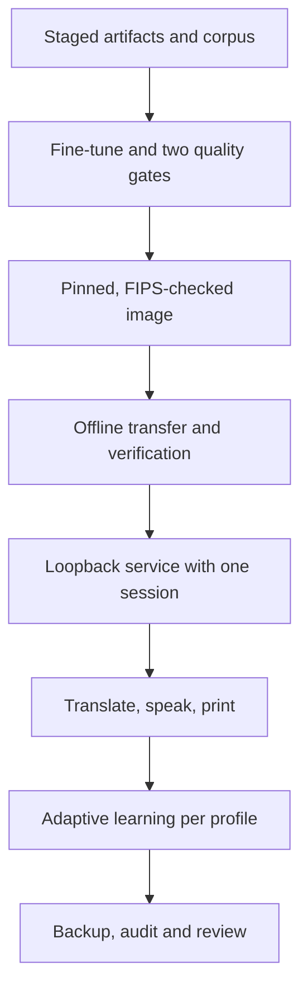

# Latin Translator — Business Value Map

**Author:** Iain Reid · **Classification:** INTERNAL · **Version:** 2.0 draft · **Date:** 2026-11-20
**Governing documents:** [PRD](../../prd.md), [Documents](../docs/README.md), [Standards matrix](../docs/standards-conformance-matrix.md), [Progress](../../progress.md)

> Generated by `tools/gen_brd.py`; do not edit by hand. Nothing here has been verified against a running system. Identifiers are standalone to this set. The product is partly built (progress.md); features say what is still to do or to prove.

| BV | Value | Beneficiaries | Measure (how we will know) | Epics |
|---|---|---|---|---|
| BV-01 | Trustworthy offline translation | Learners, parents and teachers | Both quality gates pass (spot-check >= 40/50 and chrF >= 45 each way); fallback marks only on words truly unknown | EP-02, EP-03, EP-09 |
| BV-02 | Isolated, secure runtime | Operator, Security Authority | One session only; token reuse refused 100%; no outbound network; UI reachable on the stated run line | EP-00, EP-01, EP-04, EP-10 |
| BV-03 | Verified supply chain | Security Authority, Staging Engineer | Every artifact hash-checked at build and startup; build fails on any mismatch, missing FIPS provider or network install | EP-02, EP-09, EP-10 |
| BV-04 | Learning that adapts | Learners | Level, telemetry, feedback and workbooks work per profile; clear and delete leave other profiles untouched | EP-03, EP-04, EP-05, EP-06, EP-07, EP-08 |
| BV-05 | Safe, recoverable data | Operator, Learners | Restore from backup proven monthly; migration failure changes nothing; delete erases the file | EP-05, EP-11 |
| BV-06 | Honest, standards-mapped assurance | Project Lead, Security Authority, assurance reviewer | Every control row Planned or Evidenced by a dated file; no unevidenced compliance claim | EP-00, EP-08, EP-12, EP-13 |
| BV-07 | Operable and supportable | Operator, Support Lead | SLA table measured on the target host; runbooks tested; documents current | EP-11, EP-13 |

## Value stream

