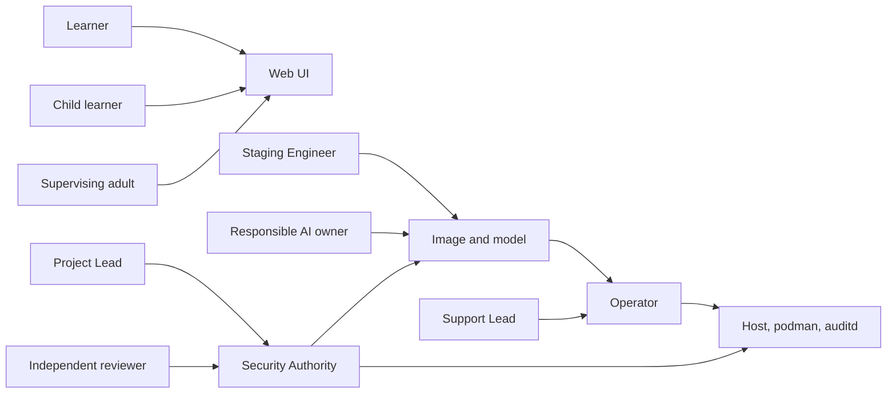

# Latin Translator — Personas

**Author:** Iain Reid · **Classification:** INTERNAL · **Version:** 2.0 draft · **Date:** 2026-11-20
**Governing documents:** [PRD](../../prd.md), [Documents](../docs/README.md), [Standards matrix](../docs/standards-conformance-matrix.md), [Progress](../../progress.md)

> Generated by `tools/gen_brd.py`; do not edit by hand. Nothing here has been verified against a running system. Identifiers are standalone to this set. The product is partly built (progress.md); features say what is still to do or to prove.

| ID | Persona | Type | Goals | Pain today | Key interactions |
|---|---|---|---|---|---|
| P-01 | Learner (adult) | direct | Translate, hear and print Latin at the right level | No feedback on weak words | Web UI |
| P-02 | Learner (child, with adult) | direct | Simple, safe, readable output | Output too hard or misleading | Web UI levels 1 to 3 |
| P-03 | Supervising adult or teacher | direct | Know what the machine did and where it is unsure | Fallback marks unclear | Result page, workbooks |
| P-04 | Operator | direct | Deploy, back up, restore and upgrade on the air-gapped host | Unproven run line; manual checks | Podman, auditd, cron |
| P-05 | Staging Engineer | direct | Build and gate the model repeatably | No run yet; empty manifest | Scripts, manifest, image build |
| P-06 | Project Lead | direct | Gated delivery and honest status | Documents claimed Baseline early | Progress, plan, gate pack |
| P-07 | Security Authority | direct | Evidence that controls hold | Claims without files | Matrix, risk register, UAT |
| P-08 | Support Lead | direct | Runbooks that match the code | Faults not reproducible | DOC-04, DOC-08 |
| P-09 | Responsible AI owner | direct | Model information, bias and out-of-design records | No model card | Quality gate, corpus register |
| P-10 | Architect | direct | Design that matches the code | PRD and code drift | DOC-01, gap list |
| P-11 | Independent reviewer | direct | Sample evidence and challenge | Self-attested evidence | Gate samples |
| P-12 | Translation engine and model | indirect (system) | Receive clean input and a valid prefix | Bad input, unverified weights | Engine, checkpoint |
| P-13 | Host auditd and cron | indirect (system) | Watch and back up on schedule | Wrong paths | Rules, crontab |

## Stakeholder flow

## Gaps

Names and deputies are CONFIRM for every role. There is no representative of the learners; P-03 stands in until a teacher or parent is consulted (OD-S3).
