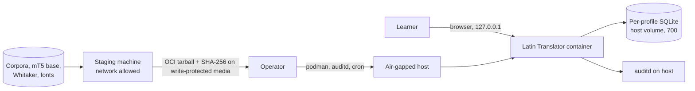
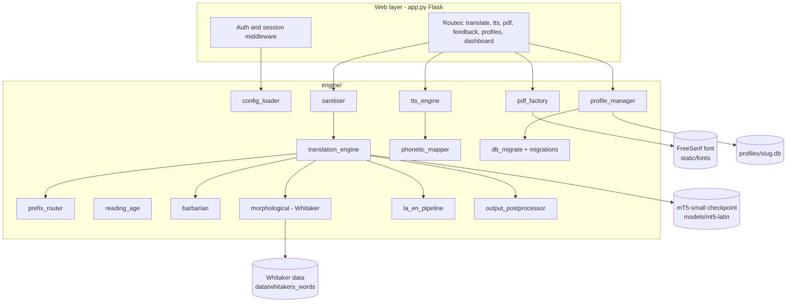
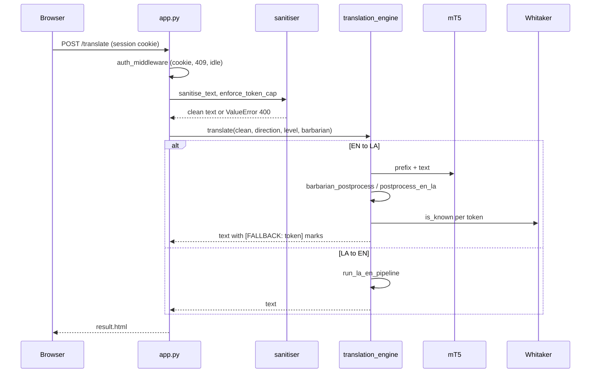
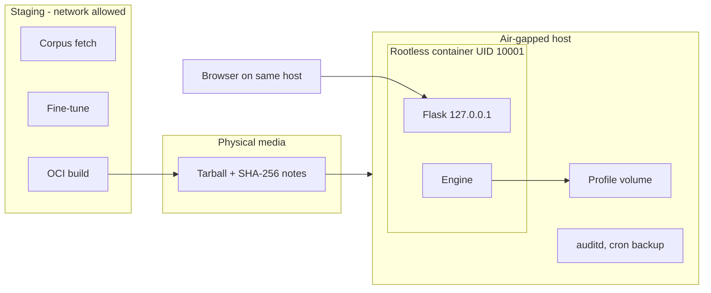

# DOC-01 Architecture Guide

| | |
|---|---|
| **Author** | Iain Reid |
| **Classification** | INTERNAL |
| **Owner** | Architect (deputy: CONFIRM) |
| **Version** | 2.0 draft (supersedes 1.0.0 in `archive-v1/`) |
| **Date** | 2026-11-20 |
| **Governing documents** | [PRD](../../prd.md), [Progress](../../progress.md), [Standards matrix](standards-conformance-matrix.md) |
| **Status** | Design description from the code read on 2026-11-20. Not verified inside a built container |

> Statements marked **[code]** were read in the source on 2026-11-20. Statements marked **[PRD]** are requirements, not proof. Anything marked **Gap** differs between the PRD and the code (see section 9).

## 1. Purpose and context

An offline, single-user, loopback-only web application that translates between UK English and Classical Latin, adapts output to a reading level, keeps per-learner telemetry, speaks Latin through espeak-ng, and prints PDF workbooks. All model weights, corpora, fonts and wheels are bundled into one OCI image built on a connected staging machine and carried to the air-gapped host on physical media [PRD s3, s7].

## 2. Component view

| Component | Role | Detail doc |
|---|---|---|
| Web layer | Loopback Flask server, token auth, single session, idle timeout, SIGTERM grace | [Web-Auth](components/Web-Auth-Architecture.md) |
| Config | Validates `config.toml`; invalid values reset with a warning | [Config](components/Config-Architecture.md) |
| Sanitiser | Strips control characters and shell metacharacters; 512-token cap; CSV string literals | [Sanitiser](components/Sanitiser-Architecture.md) |
| Translation engine | Prefix-conditioned mT5 inference; fallback annotation | [Translation](components/Translation-Architecture.md) |
| Morphology | Whitaker's Words lookup and fallback annotation | [Morphology](components/Morphology-Architecture.md) |
| Reading age and Barbarian | Level specs 1 to 6, Barbarian register | [Reading-Age](components/ReadingAge-Architecture.md) |
| TTS | Phonetic mapping then espeak-ng via pyttsx3 | [TTS](components/TTS-Architecture.md) |
| PDF factory | fpdf2 in-memory workbooks | [PDF](components/PDF-Architecture.md) |
| Profiles and learning | Per-profile SQLite, secure erase, telemetry | [Profiles](components/Profiles-Architecture.md) |
| Schema migration | Version check, integrity check, sequential scripts | [Migration](components/Migration-Architecture.md) |
| Container and supply chain | Containerfile, manifest lock, checksum script | [Container](components/Container-Architecture.md) |
| Staging pipeline | Corpus fetch, filter, fine-tune, quality gate | [Staging](components/Staging-Architecture.md) |

## 3. Request flow: translation

## 4. Data stores

| Store | Location | Content | Protection |
|---|---|---|---|
| Profile DB | `~/.airgap-translator/profiles/<slug>.db` [code] | Seven tables: `schema_version`, `profile_meta`, `word_friction`, `session_history`, `translation_feedback`, `proficiency`, `error_records` | Directory 700, file 600 [code]; no encryption at rest [PRD s4.4] |
| Session token | `~/.airgap-translator/session.token` [code] | 128-bit hex | 600; deleted on shutdown [code] |
| Config | `config/config.toml` [code] | Five keys | Operator-owned |
| Error log | `logs/error.log` [code] | UTC ISO 8601, 10 MB x 3 | User strings cut to 64 characters |
| Manifest | `corpus_manifest.lock` | SHA-256 of artifacts | **All entries commented PENDING** [code] |

Schema detail: [adaptive_learning_schema.md](adaptive_learning_schema.md).

## 5. Trust boundaries

1. Staging to media: integrity by SHA-256; provenance of the hash is a residual risk [PRD s7].
2. Media to host: operator verifies hash before `podman load`.
3. Browser to app: loopback plus token and cookie. The browser and the container are in different network namespaces, so how the browser reaches a `--network=none` container is **unproven** (section 9, G-10).

## 6. Deployment view

One container, one volume (`~/.airgap-translator`), host `auditd` and cron outside the container. See [DOC-09](DOC-09-Deployment-Guide.md) and [DOC-11](DOC-11-Podman-Container-Build-Guide.md).

## 7. Technology choices

| Choice | Rationale (PRD) | Standard checked |
|---|---|---|
| Flask | Small, loopback server. PRD says "Flask or FastAPI"; code is Flask | Python guide s2 |
| mT5-small | One checkpoint for all prefix tasks, about 300 MB, CPU-capable | JSP 936 (AI) |
| SQLite | File per profile, OS ACL boundary | ANSI SQL guide s3 |
| fpdf2 | Pure Python, no binary renderer | Python guide s1 |
| espeak-ng via pyttsx3 | Offline TTS; driver locked to `espeak` | Python guide s1 |

## 8. Performance targets

Translation 5 s, PDF 10 s, TTS start 3 s, SQLite read 200 ms, startup 30 s, fallback overhead 500 ms [PRD s2]. **No measured value exists** (checklist table is empty).

## 9. Gaps between the PRD and the code

| ID | Finding | Evidence | Effect |
|---|---|---|---|
| G-01 | **Fixed 2026-11-20** (unit tests only; not yet run in a container). Was: the `?token=` parameter is accepted on every request, not only the first; a valid token replaces the active session id | `app.py` auth_middleware; `_session_token` is not cleared after first use | A second browser holding the URL takes over the session; PRD s4.7 "not re-accepted" and the 409 rule are bypassed |
| G-02 | **Fixed 2026-11-20** (unit tests only; not yet run in a container). Startup now checks `models/mt5-latin` and `static/fonts` entries against the manifest and refuses on a missing manifest, missing file, PENDING value or mismatch. Was: checkpoint SHA-256 is not verified at startup | `TranslationEngine(verify_checksum=False)` in `app.py`; `_verify_checksum` body is `pass` | PRD s6.1 startup row not implemented |
| G-03 | **Fixed 2026-11-20** (unit and static tests only; no image built). FIPS step now fails the build unless `openssl list -providers` shows the FIPS provider (base is now RHEL 9 UBI; presence of the provider module in the image still to be confirmed by a build); pip is offline with `--require-hashes -r requirements-runtime.txt` and no fallback; `check_checksums.py --release` is fatal on mismatch, missing file, empty manifest or PENDING. Was: Containerfile FIPS step prints versions only; pip falls back to an unpinned network install; checksum failure only warns | `Containerfile` lines for FIPS, pip, `check_checksums.py ... \|\| echo WARN` | Build does not fail on missing FIPS provider, or on a hash mismatch; air-gap and pinning rules not enforced at build |
| G-04 | **Fixed 2026-11-20** (unit and static tests only; no image built). Package removed (`shred` is in coreutils; `libssl-dev` also dropped); `.containerignore` added. Was: `apt-get install shred` is listed | `Containerfile` | `shred` is part of coreutils, not a package I know of; build may fail (verify in Stage 0) |
| G-05 | **Fixed 2026-11-20** (unit tests only; not yet run in a container). All pending migrations now run in one explicit transaction; PRAGMAs run first; any failure rolls back. Was: migration runs by `executescript`, which commits as it goes; the version update for version 1 comes from the script | `db_migrate.py` | PRD "single transaction with rollback" not met |
| G-06 | **Fixed 2026-11-20** (unit tests only; not yet run in a container). `check_profiles()` runs at startup: corrupt files are reported (log, stderr, Profiles page) and skipped, healthy ones are migrated. Was: `PRAGMA integrity_check` runs only inside `run_migrations`, which `create_profile` calls; existing profiles are not checked at startup | `profile_manager.py`, `app.py` main | PRD s4.8 corruption detection at startup not met |
| G-07 | **Fixed 2026-11-20** (unit tests only; not yet run in a container). `_db_path` now allows only `[a-z0-9_-]{1,64}`. Was: `/profile/delete` accepts any `slug` and builds a path from it | `app.py`, `_db_path` | A slug containing `../` could reach another `.db` file and `shred` it (authenticated user only) |
| G-08 | **Fixed 2026-11-20** (unit tests only; not yet run in a container). Per-session CSRF value checked on every POST (403 otherwise), SameSite=Strict cookie, CSP and four other headers; inline handlers moved to `main.js`. Was: no CSRF token on state-changing POST routes | `app.py` | A page in the same browser could post to `127.0.0.1:<port>` while a session is live |
| G-09 | **Fixed 2026-11-20** (unit tests only). Added `/profile/rename`, `/set-error-mode`, `/import` (GET and POST) with templates; the profile error mode now reaches the engine. Not done: live per-chunk progress (the page reports chunks after the run) and writing session history rows. Was: no route for corpus import, profile rename, error-mode switch or session history; the engine's `strict_mode` is never set from the profile | `app.py` | Several PRD s4 features have engine or schema support but no UI path |
| G-10 | **Still open.** Prerequisites added 2026-11-20: `server.bind` config key (default `127.0.0.1`; `0.0.0.0` only for spike option B and needs a PRD decision) and a port-aware `scripts/healthcheck.py`. The spike itself needs a Podman host. Was: `-p 127.0.0.1:8080:8080` is combined with `--network=none` and a `127.0.0.1` bind inside the container | README quick start, `app.run(host="127.0.0.1")` | Likely unreachable from the host browser; needs a Stage 0 spike |
| G-11 | **Partly fixed 2026-11-20** (unit tests): with no dictionary loaded no token is marked and a warning is logged. Still open: confidence is a dictionary heuristic, not a model score (BRD FEAT-08). Was: the fallback "confidence" is 1.0 or 0.5 from a dictionary hit, not a model score; with no Whitaker data every alphabetic token becomes `[FALLBACK: x]` | `translation_engine.py` translate, `morphological.py` | Output is misannotated until the data bundle exists; PRD s4.1 not met |
| G-12 | **Still open; cannot be closed by editing.** `scripts/check_artifacts.py` now lists what is missing (7 of 8 checks fail on 2026-11-20; only the 50-pair spot-check file is present). Artifacts need a networked staging run. Was: artifacts are absent from the tree: `models/`, `data/whitakers_words`, `static/fonts`, `wheels/`, `corpus/validation_split.tsv` | File listing 2026-11-20 | Nothing can be built or measured end to end yet |
| G-13 | Old documents said Baseline and Approved while the manifest, quality gate, SLA and sign-off are pending | `archive-v1/`, `progress.md` | Replaced by Draft status and Planned/Evidenced wording |
| G-14 | `docs/latin.json` (79 KB) has no description or owner | File listing | Purpose unknown; left in place |

## 10. Known gaps in this document

No owner review; ports, host sizes and frequencies beyond the PRD are CONFIRM; the `tts_engine` export path was read only at its header; diagrams are Mermaid and not rendered in a viewer.

## Sources

- [PRD](../../prd.md) s2 to s9; `app.py`, `engine/*.py`, `Containerfile`, `corpus_manifest.lock` read 2026-11-20.
- [Standards README](../../../aip/standards/README.md); Python guide s1, s2; ANSI SQL guide s3.
