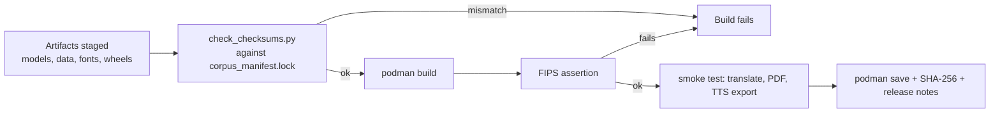

# DOC-11 Podman Container Build Guide

| | |
|---|---|
| **Author** | Iain Reid |
| **Classification** | INTERNAL |
| **Owner** | Staging Engineer (deputy: CONFIRM) |
| **Version** | 2.0 draft (supersedes 1.0.0 `archive-v1/CONTAINER_BUILD_GUIDE.md`) |
| **Date** | 2026-11-20 |
| **Governing documents** | [PRD](../../prd.md) s6.1, s7, s9.13, [fips_verification.md](fips_verification.md) |
| **Status** | Procedure plus findings. **No image has ever been built from this tree** |

> Nothing here has been verified against a running system.

## 1. Build flow

## 2. What the Containerfile does today [code]

| Step | Content | Finding |
|---|---|---|
| Base | `registry.access.redhat.com/ubi9/ubi:latest` (decision 2026-11-20) | Pin by digest before release; confirm the OpenSSL FIPS provider module is present in the image |
| Packages | python3.11, venv, pip, openssl, libssl-dev, espeak-ng, espeak-ng-data, `shred` | `shred` is coreutils (G-04); drop `libssl-dev` and `pip` in a final stage |
| FIPS | Prints OpenSSL version | **Not an assertion (G-03)** |
| User | UID 10001, group 0 | OK |
| Copy | `COPY . /app/` | Copies tests, docs, logs and caches into the image; add `.containerignore` |
| Wheels | `pip install --no-index --find-links=/app/wheels ... \|\| pip install ...` | **Network fallback, unpinned (G-03)**; also installs no `transformers`, `torch`, `sacrebleu` or `sentencepiece`, which `translation_engine.py` imports |
| Checksums | `check_checksums.py \|\| echo WARN` | **Mismatch only warns (G-03)** |
| Directories | profiles 700, logs | Logs in `/app/logs` while PRD says `/logs/error.log` (CONFIRM) |
| Health | TCP connect to 8080 | Port fixed |
| CMD | `python3.11 app.py` | OK |

## 2a. Changes made 2026-11-20 (static tests only; **no image has been built**)

- Base: **RHEL 9 UBI** (decided 2026-11-20). `dnf` installs python3.11, pip and openssl from the UBI repositories on the staging machine. espeak-ng is not in UBI or RHEL: its RPMs and dependencies are collected on staging into `rpms/` (EPEL 9), listed in the manifest and installed offline with `--disablerepo='*'`. Not built or run.
- FIPS: build fails unless the FIPS provider is listed. Kernel FIPS mode is a host setting, not an image one: the Operator must confirm it on the air-gapped host (new checklist item).
- Wheels: `requirements-runtime.txt` is a names-only list; versions and hashes must be generated on staging before the build can pass (it fails closed by design). It now includes transformers, torch and sentencepiece.
- Checksums: `check_checksums.py --release` fails on PENDING or an empty manifest, so no image can be built before the model gate has passed.
- `shred` and `libssl-dev` removed; `.containerignore` added (tests, docs, brd, tools, logs, markdown).
- Still open: multi-stage build, read-only root filesystem, port-aware health check, run line (G-10).

## 3. Required changes (tracked in the BRD, EP-09)

1. Pinned, hash-checked wheelhouse; `pip install --no-index --require-hashes`; no fallback.
2. Real FIPS check: fail the build if the provider cannot be loaded (method CONFIRM for the chosen base: RHEL 9 UBI is simpler than Ubuntu).
3. `check_checksums.py` must fail the build, and fail on `PENDING` entries in a release build.
4. Verify the checkpoint and fonts at startup (G-02).
5. `.containerignore`; multi-stage build; run as non-root; read-only root filesystem with tmpfs for logs (CIS).
6. Replace the port-publish run line after the G-10 spike.

## 4. Tagging

`airgap-translator:<major.minor.patch>`; a model refresh bumps the minor number and the checkpoint version (PRD s7.1).

## 5. Release outputs

Tarball, SHA-256, release notes (versions, manifest hash, quality-gate result, scan record, SBOM), model card.

## Sources

`Containerfile`; `scripts/check_checksums.py`; [PRD](../../prd.md) s6.1, s7, s9.13; Python guide s1; CIS and STIG items as mapped in [DOC-07](DOC-07-Security-Analysis-and-Compliance.md).
