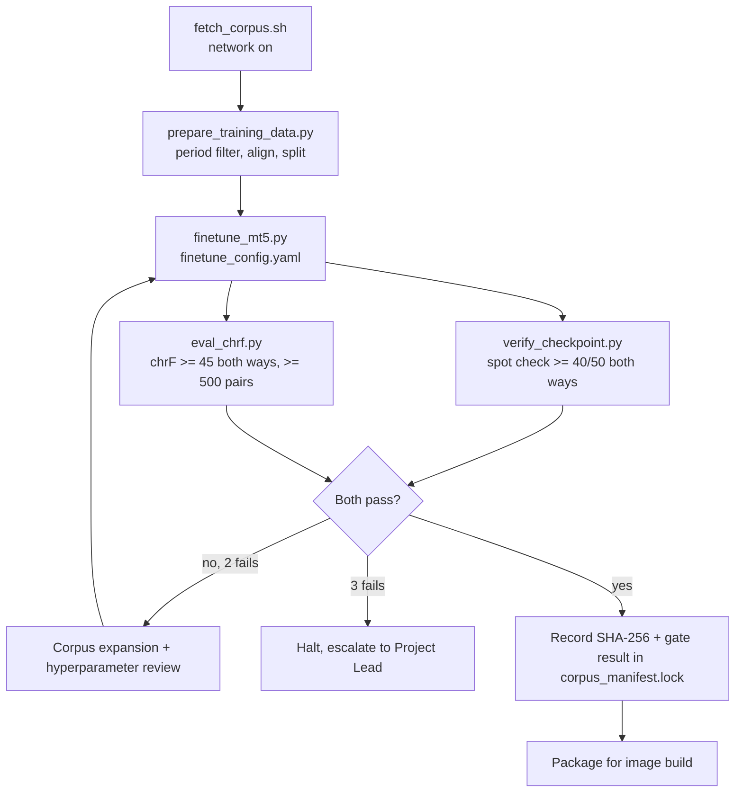

# DOC-12 Staging Machine and Model Build Guide

| | |
|---|---|
| **Author** | Iain Reid |
| **Classification** | INTERNAL |
| **Owner** | Staging Engineer (deputy: CONFIRM) |
| **Version** | 2.0 draft |
| **Date** | 2026-11-20 |
| **Governing documents** | [PRD](../../prd.md) s4.2a, s7.1, [finetuning_procedure.md](finetuning_procedure.md) (build record template) |
| **Status** | Procedure only. **No staging run has happened**: `corpus_manifest.lock` is all PENDING, and `models/` does not exist |

> This document replaces the container-template guide that the reference set calls DOC-12. The Latin tool has no VM template; its equivalent build step is the staging machine and model build.

> Nothing here has been verified against a running system.

## 1. Staging machine

| Item | Requirement (PRD s4.2a) |
|---|---|
| OS | Ubuntu 22.04 LTS x86-64, or Windows 10/11 with WSL2 Ubuntu 22.04 |
| Python | 3.11.x pinned in `scripts/requirements-staging.txt` |
| RAM, disk | 16 GB minimum (32 GB comfortable); 20 GB free |
| GPU | Optional (8 GB VRAM); CPU-only baseline |
| Time | About 8 to 14 hours CPU-only, 45 to 90 minutes with GPU, 3 epochs |
| Network | Only during `fetch_corpus.sh`; disconnect before training. The image build (`podman build`) also needs the network for the UBI repositories and the EPEL RPM download |

The tests in the repository ran on Python 3.12.9 on Windows on 2026-11-20 (176 passed); the target is 3.11. Run the suite again on the staging OS.

## 2. Procedure

1. Fetch corpora and base weights; record each source URL, date and licence.
2. Filter: Classical period only (PRD s4.2a rules for Vulgate, LatinISE, Perseus); record retained and excluded counts per source.
3. Fine-tune with the version-controlled config.
4. Run **both** gates. A pass on one does not count.
5. Write checksums and the gate record (checkpoint version, chrF per direction, spot-check count, date, operator). The record is immutable; corrections are new entries.
6. Malware-scan the output; copy to write-protected media.

## 3. Evidence for the AI standards

| Evidence | Standard row | Where it lives |
|---|---|---|
| Dataset register (train, validation, spot-check separate) | JSP936-DAT-01 | build record |
| Source, licence, date, hash | JSP936-DAT-02, SUP-03 | manifest |
| Model information package | JSP936-MDL-01 | new `model-card.md` (task in BRD) |
| Per-level and per-direction results | JSP936-VV-01 | build record |
| Rationale for hyperparameter changes | JSP936-LCY-05 | build record |
| Bias note on the corpus (Christian and military text skew) | JSP936-ETH-04 | model card |

## 4. Known gaps

`validation_split.tsv` is a placeholder (progress 2.4); the script `check_checksums.py` and the manifest format `artifact=... sha256=...` need a real run to prove the loop; `chrF` stratification by level has not been demonstrated because no checkpoint exists.

## Sources

[PRD](../../prd.md) s4.2a, s7.1; [progress.md](../../progress.md) Phase 2; `scripts/` file list; `corpus_manifest.lock`.
