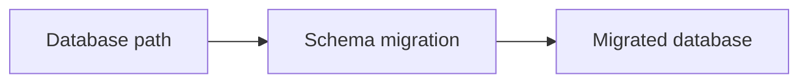

# Schema migration

**Author:** Iain Reid · **Classification:** INTERNAL · **Version:** 2.0 draft · **Date:** 2026-11-20
**Governing documents:** [PRD](../../../prd.md), [DOC-01](../DOC-01-Architecture-Guide.md), [Standards matrix](../standards-conformance-matrix.md)

> Generated by `tools/gen_components.py`; do not edit by hand. Read from the code on 2026-11-20. Nothing here has been verified in a built container.

| | |
|---|---|
| **Layer** | L5 Data |
| **Purpose** | Checks integrity, compares schema version, applies numbered SQL scripts. |

## Files

- `engine/db_migrate.py`
- `engine/migrations/001.sql`

## Inputs and outputs

| Inputs | Outputs |
|---|---|
| Database path | Migrated database Exit 1 on failure |

## Controls present in the code

- Integrity check before migrate
- Future-version refusal
- `executescript` for each script

## Standards

- ANSI SQL s11
- SBD-ASR-03

## Gaps

- Fixed 2026-11-20, unit tests only: G-05 single transaction, G-06 startup integrity check
- 001.sql sets WAL mode: the PRD says WAL is not needed and WAL adds `-wal` and `-shm` files to backups and erase

## Tests

- test_schema_migration.py

## Diagram

