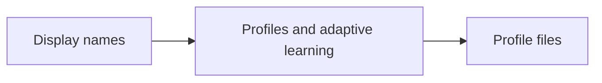

# Profiles and adaptive learning

**Author:** Iain Reid · **Classification:** INTERNAL · **Version:** 2.0 draft · **Date:** 2026-11-20
**Governing documents:** [PRD](../../../prd.md), [DOC-01](../DOC-01-Architecture-Guide.md), [Standards matrix](../standards-conformance-matrix.md)

> Generated by `tools/gen_components.py`; do not edit by hand. Read from the code on 2026-11-20. Nothing here has been verified in a built container.

| | |
|---|---|
| **Layer** | L5 Data |
| **Purpose** | One SQLite file per learner: metadata, friction, feedback, proficiency, history, errors. Create, list, rename, delete (secure erase), clear telemetry. |

## Files

- `engine/profile_manager.py`
- `docs/adaptive_learning_schema.md`

## Inputs and outputs

| Inputs | Outputs |
|---|---|
| Display names feedback ratings | Profile files counts for the dashboard |

## Controls present in the code

- Directory 700, file 600
- Parameterised SQL; allow-listed column names
- Single writer lock `_WRITE_LOCK`
- Delete: `shred -uz` then Python overwrite fallback

## Standards

- ANSI SQL s3, s13
- JSP441 INF-LC-01, INF-PRV-01
- OWASP A03

## Gaps

- Fixed 2026-11-20, unit tests only: G-07 slug validation
- Reads are not under the lock; one connection per call
- Overwrite fallback does not fsync
- No privacy impact record for learner names

## Tests

- test_adaptive_learning.py

## Diagram

