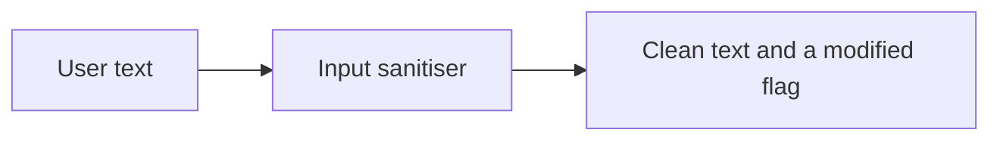

# Input sanitiser

**Author:** Iain Reid · **Classification:** INTERNAL · **Version:** 2.0 draft · **Date:** 2026-11-20
**Governing documents:** [PRD](../../../prd.md), [DOC-01](../DOC-01-Architecture-Guide.md), [Standards matrix](../standards-conformance-matrix.md)

> Generated by `tools/gen_components.py`; do not edit by hand. Read from the code on 2026-11-20. Nothing here has been verified in a built container.

| | |
|---|---|
| **Layer** | L2 Input |
| **Purpose** | NFC-normalises text, strips control and shell characters, caps input at 512 whitespace tokens, neutralises CSV formula cells, chunks corpus text. |

## Files

- `engine/sanitiser.py`

## Inputs and outputs

| Inputs | Outputs |
|---|---|
| User text CSV rows Corpus text | Clean text and a modified flag ValueError over the cap Log-safe truncation |

## Controls present in the code

- Regex strip of C0, C1, DEL and `; & | $ < > \` and backtick
- Cell prefix `'` for `= + - @`
- 64-character log truncation

## Standards

- OWASP A03
- NIST SI-10
- Python guide s1
- SBD-CTL-02

## Gaps

- Cap counts whitespace words, not mT5 tokens (PRD says after tokenisation)
- Strips `$ < > \` from ordinary text
- Corpus import route does not exist (G-09)

## Tests

- test_input_sanitisation.py

## Diagram

