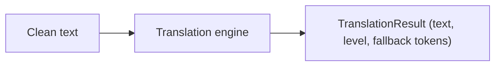

# Translation engine

**Author:** Iain Reid · **Classification:** INTERNAL · **Version:** 2.0 draft · **Date:** 2026-11-20
**Governing documents:** [PRD](../../../prd.md), [DOC-01](../DOC-01-Architecture-Guide.md), [Standards matrix](../standards-conformance-matrix.md)

> Generated by `tools/gen_components.py`; do not edit by hand. Read from the code on 2026-11-20. Nothing here has been verified in a built container.

| | |
|---|---|
| **Layer** | L3 Model |
| **Purpose** | Builds a task prefix, runs the fine-tuned mT5-small checkpoint, post-processes, and annotates unknown tokens. |

## Files

- `engine/translation_engine.py`
- `engine/prefix_router.py`
- `engine/output_postprocessor.py`
- `engine/la_en_pipeline.py`

## Inputs and outputs

| Inputs | Outputs |
|---|---|
| Clean text direction level or Barbarian | TranslationResult (text, level, fallback tokens) |

## Controls present in the code

- Explicit direction (default `en-la` if missing)
- Prefix validated against level and direction
- Model loaded once, eval mode, no_grad

## Standards

- JSP936-REL-02, REL-03, VV-01
- SBD-ASR-02
- NIST SI-7 (planned)

## Gaps

- Fixed 2026-11-20, unit tests only: G-02 startup checksum (`ChecksumError`)
- G-11 confidence is a dictionary heuristic, not a model score
- Default direction hides the user-choice rule
- `strict_mode` never set from the profile

## Tests

- test_translation_engine.py
- test_reading_age.py (mock model)

## Diagram

