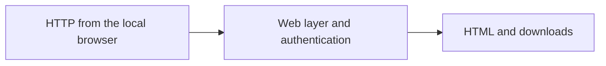

# Web layer and authentication

**Author:** Iain Reid · **Classification:** INTERNAL · **Version:** 2.0 draft · **Date:** 2026-11-20
**Governing documents:** [PRD](../../../prd.md), [DOC-01](../DOC-01-Architecture-Guide.md), [Standards matrix](../standards-conformance-matrix.md)

> Generated by `tools/gen_components.py`; do not edit by hand. Read from the code on 2026-11-20. Nothing here has been verified in a built container.

| | |
|---|---|
| **Layer** | L1 Interface |
| **Purpose** | Loopback Flask server with token login, one active session, idle timeout and a 5-second SIGTERM grace window. |

## Files

- `app.py`
- `templates/`
- `static/`

## Inputs and outputs

| Inputs | Outputs |
|---|---|
| HTTP from the local browser config values SIGTERM | HTML and downloads session.token file `Ready:` line on stdout error.log entries |

## Controls present in the code

- Bind 127.0.0.1 only
- 128-bit `secrets.token_hex(16)` token, file mode 600
- 302 strip of the token
- 409 for a second session
- 401 after idle
- Port-in-use exit 1

## Standards

- Python guide s2 (Flask)
- OWASP A01, A05, A07
- NIST AC-3, IA-5
- SBD-CTL-02

## Gaps

- Fixed 2026-11-20, unit tests only: G-09 import, rename and error-mode routes (no live chunk progress)
- `server.bind` key added for the G-10 spike
- Fixed 2026-11-20, unit tests only: G-01 token single use, G-08 CSRF and headers
- CSP forbids inline script: new templates must not use inline handlers

## Tests

- test_auth_session.py
- test_port_startup.py

## Diagram

